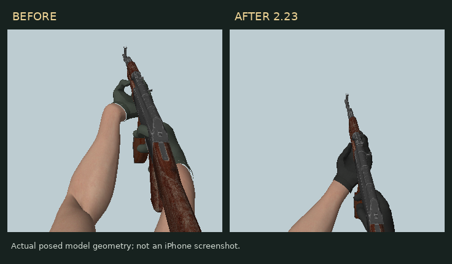

# 荒野前线 · Wild Frontier FPS

从原站工程恢复的完整网页版 3D FPS。部署入口为 `dist/index.html`，包含约 246 MB 的本地资源，模型、材质和音效随工程提供，无需从外部 CDN 下载。

## 包含内容

- 起伏山地、湖泊、河流、海岸、村落与可进入房屋。
- 带骨骼和走跑动作的人物模型，12 名 AI 敌人。
- M700 狙击枪、GL-6 榴弹炮、AKM 步枪模型、瞄具、持枪手臂与布手套。
- 可驾驶越野车、车辆碰撞、水花、轮胎印和排气。
- 本地摄影材质、2K 材质升级、HDR 环境与动态阴影。
- 电脑键鼠和手机触控操作，首次启动需要下载战场资源。

工程以恢复的原 2.22 版本为基础，当前版本为 2.24。它仍是网页版游戏工程，不代表已达到商业 3A 成品质量。

## 2.24 场景互动与敌人喊话

- 越野车前进或倒车撞到仙人掌时，植株沿撞击方向倾倒、触地轻微回弹并保留在地上。倒伏方向会考虑坡度，重新部署才恢复；连续碰撞检测可处理快速行驶和转弯。
- 全岛固定布置约 1.86 万丛稀疏野草，具有弯曲叶片、枯绿变化、少量穗梗和轻微风摆，避开水面、道路和房屋。车轮经过会压低草叶。
- 三种固定中文敌人声线：年轻侦察兵、低沉老兵、有力队长，共 24 条本地合成语音。包括“发现他了”“他在那里”等发现、交火、换弹、搜索、车辆和榴弹喊话，按 AI 实际状态触发。
- 语音具有方位、距离衰减与掩体闷声，同一时间只让一名敌人喊话；暂停、静音或喊话者被击败会立即停止，配有中文字幕。
- 新音频不到 0.5 MB，独立于原大型资源包下载；游戏运行时无需配音服务账号或 API。生成脚本、声线来源和全部台词在工程中保留，这些是合成语音。

## 2.23 手臂与握枪修正

- 保持枪械握点，重新求解手腕与肘部朝向；上臂、前臂和手指不拉伸。
- 调整竖屏持枪比例和位置，肩部断面退出画面；布手套改为接近中性的黑色。
- 调整机械瞄具的观察距离，开镜时不再把上臂断面带到镜头前，保持前后照门与准星同轴。
- 增加三把枪的姿势、骨长、镜头与瞄准路径检查。模型原生渲染用于姿势检查，不代表 iPhone 实机画面。

## GitHub Pages 部署

1. 将此工程内容提交到仓库 `main` 分支，保留 `dist`、`scripts`、`package.json` 和 `.github/workflows/pages.yml`。
2. 仓库 **Settings → Pages → Build and deployment → Source** 选择 **GitHub Actions**。
3. 打开 **Actions → Publish Wild Frontier → Run workflow**，等待部署完成。后续推送 `main` 会自动更新。
4. 在线地址以成功的 Actions 部署结果为准，支持 GitHub 项目站点的子路径。

GitHub Free 使用公开仓库发布 Pages；私有仓库是否支持 Pages 取决于 GitHub 计划。模型、照片及其他资产的原有版权与授权说明均保留在工程中。

## 本地预览

在此目录运行 `python -m http.server 8000 --directory dist`，浏览器访问 `http://localhost:8000`。iPhone 请用 Safari 打开 HTTPS 在线地址，建议横屏。

## 检查与素材来源

- `node scripts/check-static.mjs`：无依赖检查游戏模块语法、项目站点相对路径、3D 模型及其纹理/几何依赖。
- `npm run check:field`：检查连续碰撞、三类仙人掌落地/坡度/暂停/重置、野草布局与车轮压草，以及角色语音资源和触发规则。
- `node scripts/check.mjs`：原工程 70 项玩法与场景检查，先运行 `npm install` 安装开发依赖。
- `ORIGINAL-CHANGELOG.md`：恢复工程原有的实现、检查范围与限制说明。
- `dist/ASSET-CREDITS.txt`、`sources/` 及模型目录中的 `SOURCE.md`/`LICENSE.md`：素材来源和授权。
